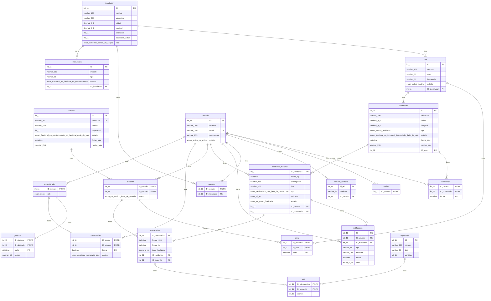

# Modelo físico de la base de datos `cathartes`

Generado desde la base real (`db/BD.sql`). Motor InnoDB, charset utf8mb4. El diagrama se visualiza directamente en GitHub (Mermaid).

Total: **20 tablas**.

## Tablas y columnas

### `administrador`

| Columna | Tipo | Nulo | Clave |
|---|---|---|---|
| ID_usuario | int(11) | No | PK, FK → usuario |
| jefe | enum('si','no') | No |  |

### `autorizacion`

| Columna | Tipo | Nulo | Clave |
|---|---|---|---|
| ID_admin | int(11) | No | PK, FK → administrador |
| ID_usuario | int(11) | No | PK, FK → usuario |
| fecha | datetime | No | PK |
| accion | enum('aprobada','rechazada','baja') | No |  |

### `camion`

| Columna | Tipo | Nulo | Clave |
|---|---|---|---|
| ID | int(11) | No | PK |
| matricula | varchar(20) | No | UNIQUE |
| modelo | varchar(100) | No |  |
| capacidad | int(11) | No |  |
| estado | enum('funcional','en mantenimiento','no funcional','dado de baja') | No |  |
| fecha_baja | datetime | Sí |  |
| motivo_baja | varchar(255) | Sí |  |

### `contenedor`

| Columna | Tipo | Nulo | Clave |
|---|---|---|---|
| ID | int(11) | No | PK |
| ubicacion | varchar(200) | No |  |
| latitud | decimal(9,6) | Sí |  |
| longitud | decimal(9,6) | Sí |  |
| tipo | enum('basura','reciclable') | No |  |
| estado | enum('funcional','no funcional','desbordado','dado de baja') | No |  |
| fecha_baja | datetime | Sí |  |
| motivo_baja | varchar(255) | Sí |  |
| ID_ruta | int(11) | No | FK → ruta |

### `cuadrilla`

| Columna | Tipo | Nulo | Clave |
|---|---|---|---|
| ID_usuario | int(11) | No | PK, FK → usuario |
| ID_camion | int(11) | Sí | FK → camion, UNIQUE |
| estado | enum('en servicio','fuera de servicio') | No |  |

### `gestiona`

| Columna | Tipo | Nulo | Clave |
|---|---|---|---|
| ID_ejecutor | int(11) | No | PK, FK → administrador |
| ID_afectado | int(11) | No | PK, FK → administrador |
| fecha | datetime | No | PK |
| accion | varchar(50) | No |  |

### `incidencia_historial`

| Columna | Tipo | Nulo | Clave |
|---|---|---|---|
| ID_incidencia | int(11) | No | PK |
| fecha_ing | datetime | No |  |
| descripcion | varchar(255) | Sí |  |
| foto | varchar(255) | Sí |  |
| tipo | enum('desbordado','roto','falta de recoleccion') | No |  |
| validada | enum('si','no') | No |  |
| estado | enum('en curso','finalizada') | No |  |
| ID_usuario | int(11) | No | FK → usuario |
| ID_contenedor | int(11) | No | FK → contenedor |

### `instalacion`

| Columna | Tipo | Nulo | Clave |
|---|---|---|---|
| ID | int(11) | No | PK |
| nombre | varchar(100) | No |  |
| ubicacion | varchar(200) | No |  |
| latitud | decimal(9,6) | Sí |  |
| longitud | decimal(9,6) | Sí |  |
| capacidad | int(11) | No |  |
| ocupacion_actual | int(11) | No |  |
| tipo | enum('vertedero','centro de acopio') | No |  |

### `intervencion`

| Columna | Tipo | Nulo | Clave |
|---|---|---|---|
| ID_intervencion | int(11) | No | PK |
| fecha_inicio | datetime | No |  |
| fecha_fin | datetime | Sí |  |
| tarea_finalizada | enum('si','no') | No |  |
| ID_incidencia | int(11) | No | FK → incidencia_historial |
| ID_cuadrilla | int(11) | No | FK → cuadrilla |

### `maquinaria`

| Columna | Tipo | Nulo | Clave |
|---|---|---|---|
| ID | int(11) | No | PK |
| modelo | varchar(100) | No |  |
| tipo | varchar(50) | No |  |
| estado | enum('funcional','no funcional','en mantenimiento') | No |  |
| ID_instalacion | int(11) | No | FK → instalacion |

### `notificacion`

| Columna | Tipo | Nulo | Clave |
|---|---|---|---|
| ID | int(11) | No | PK |
| ID_usuario | int(11) | No | FK → usuario |
| ID_incidencia | int(11) | Sí | FK → incidencia_historial |
| tipo | varchar(50) | No |  |
| mensaje | varchar(255) | No |  |
| fecha | datetime | No |  |
| leida | enum('si','no') | No |  |

### `operario`

| Columna | Tipo | Nulo | Clave |
|---|---|---|---|
| ID_usuario | int(11) | No | PK, FK → usuario |
| ID_instalacion | int(11) | No | FK → instalacion |

### `repuestos`

| Columna | Tipo | Nulo | Clave |
|---|---|---|---|
| ID | int(11) | No | PK |
| nombre | varchar(100) | No |  |
| tipo | varchar(50) | No |  |
| cantidad | int(11) | No |  |

### `ruta`

| Columna | Tipo | Nulo | Clave |
|---|---|---|---|
| ID | int(11) | No | PK |
| nombre | varchar(100) | No |  |
| zona | varchar(50) | No |  |
| frecuencia | varchar(50) | No |  |
| estado | enum('activa','inactiva') | No |  |
| ID_instalacion | int(11) | No | FK → instalacion |

### `toma`

| Columna | Tipo | Nulo | Clave |
|---|---|---|---|
| ID_cuadrilla | int(11) | No | PK, FK → cuadrilla |
| ID_ruta | int(11) | No | PK, FK → ruta |
| fecha | datetime | No | PK |

### `usa`

| Columna | Tipo | Nulo | Clave |
|---|---|---|---|
| ID_intervencion | int(11) | No | PK, FK → intervencion |
| ID_repuesto | int(11) | No | PK, FK → repuestos |
| cuantos | int(11) | No |  |

### `usuario`

| Columna | Tipo | Nulo | Clave |
|---|---|---|---|
| ID | int(11) | No | PK |
| nombre | varchar(100) | No |  |
| email | varchar(150) | No | UNIQUE |
| contrasena | varchar(255) | No |  |
| estado | enum('activo','no activo') | No |  |

### `usuario_telefono`

| Columna | Tipo | Nulo | Clave |
|---|---|---|---|
| id_tel | int(11) | No | PK |
| telefono | varchar(20) | No |  |
| ID_usuario | int(11) | No | FK → usuario |

### `vecino`

| Columna | Tipo | Nulo | Clave |
|---|---|---|---|
| ID_usuario | int(11) | No | PK, FK → usuario |

### `verificacion`

| Columna | Tipo | Nulo | Clave |
|---|---|---|---|
| ID_usuario | int(11) | No | PK, FK → usuario |
| ID_contenedor | int(11) | No | PK, FK → contenedor |
| fecha | datetime | No | PK |
